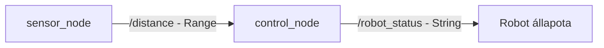

# Robot Control

## Autonóm járművek és robotok programozása

ROS 2 Humble alapú, Python nyelven megvalósított robotvezérlési szimuláció.

### A projekt célja

A program egy egyszerű autonóm robot távolságérzékelésen alapuló vezérlését szimulálja. A szenzornode véletlenszerű távolságértékeket állít elő, a vezérlőnode pedig ezek alapján meghatározza a robot állapotát.

### Node-ok

- **`sensor_node`** – másodpercenként véletlenszerű távolságértéket publikál.
- **`control_node`** – feliratkozik a távolságadatokra, és meghatározza a robot állapotát.

### Topicok

| Topic | Üzenettípus | Szerep |
|---|---|---|
| `/distance` | `sensor_msgs/msg/Range` | Távolságadatok továbbítása |
| `/robot_status` | `std_msgs/msg/String` | A vezérlési állapot továbbítása |

### Vezérlési logika

- 0,5 méter alatt: `STOP`
- 0,5–1,0 méter között: `SLOW DOWN`
- 1,0 méter felett: `FORWARD`

### Követelmények

- Ubuntu 22.04
- ROS 2 Humble
- Python 3
- `colcon`

### Fordítás

A munkakönyvtárban:

```bash
cd ~/robot_control_ws
source /opt/ros/humble/setup.bash
colcon build
source install/setup.bash
```

### Futtatás

Első terminál:

```bash
source /opt/ros/humble/setup.bash
source ~/robot_control_ws/install/setup.bash
ros2 run robot_control sensor_node
```

Második terminál:

```bash
source /opt/ros/humble/setup.bash
source ~/robot_control_ws/install/setup.bash
ros2 run robot_control control_node
```

A program szimulált távolságértékekkel működik; valódi robotot nem vezérel.

### Node-kapcsolatok


